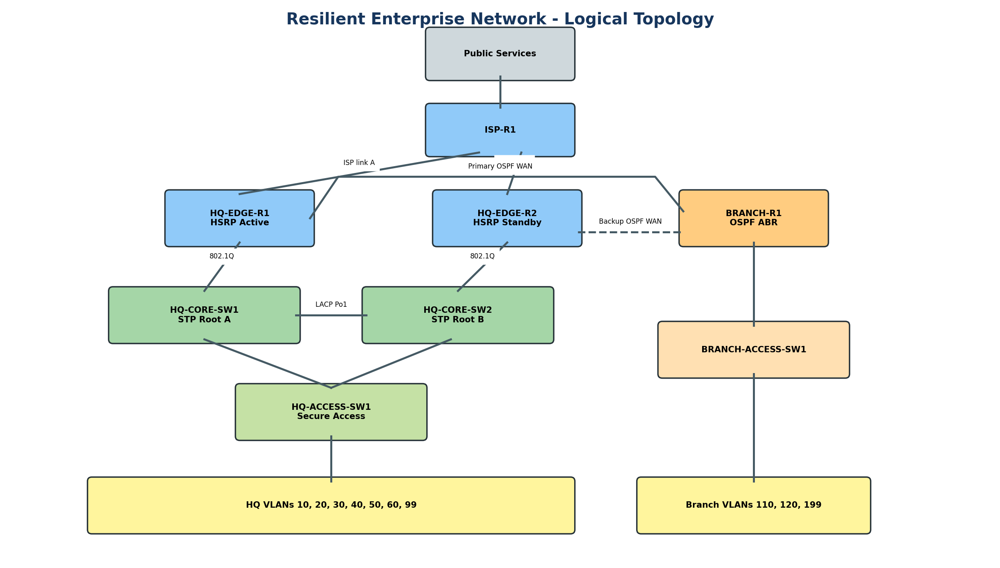
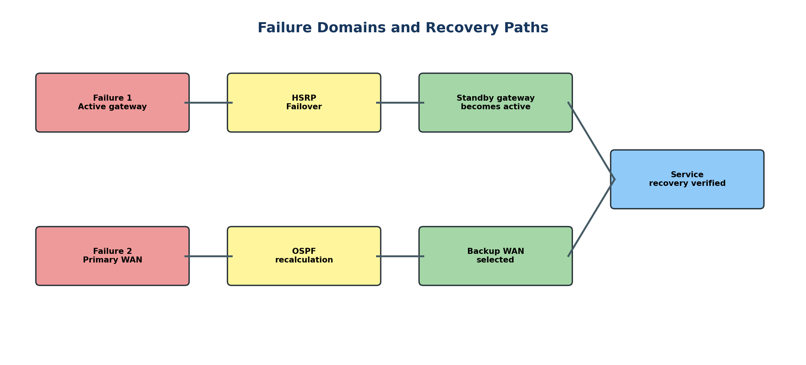

# Resilient Enterprise Network Capstone


A two-site enterprise network (headquarters + branch + simulated ISP) built to survive gateway, uplink and WAN failures. It combines redundant gateways, multi-area dynamic routing, VLAN segmentation, Layer 2 security, NAT/PAT and monitoring, and is validated with a 20-case acceptance test plan and an evidence checklist.



## Table of contents

- [Highlights](#highlights)
- [Architecture](#architecture)
- [Addressing and VLAN plan](#addressing-and-vlan-plan)
- [Design decisions](#design-decisions)
- [Repository layout](#repository-layout)
- [Getting started](#getting-started)
- [Verification](#verification)
- [Failure scenarios](#failure-scenarios)
- [Test plan](#test-plan)
- [Known limitations](#known-limitations)
- [Skills demonstrated](#skills-demonstrated)
- [Author](#author)

## Highlights

| Area | Implementation |
|---|---|
| Gateway redundancy | HSRP on every HQ VLAN. `HQ-EDGE-R1` priority 120 (active), `HQ-EDGE-R2` priority 110 (standby), preemption enabled |
| Routing | OSPFv2 process 10: area 0 (HQ + WAN links), area 10 (branch) with `area 10 range 10.20.0.0/16` summarization on the ABR. OSPFv3 on selected dual-stack networks |
| WAN failover | Two point-to-point /30 links. Primary path OSPF cost 10, backup cost 50 |
| Switching | 802.1Q trunks, LACP EtherChannel (`Po1`) between core switches, Rapid-PVST+ with per-VLAN root split |
| Segmentation | 7 HQ VLANs, 3 branch VLANs, unused native VLAN 999 |
| Layer 2 security | Port security (sticky), DHCP snooping, Dynamic ARP Inspection, BPDU Guard, storm control |
| Edge | NAT/PAT overload on both edge routers, default route to ISP, `default-information originate` into OSPF |
| Policy | `GUEST-INTERNET-ONLY` ACL on VLAN 60 blocks all RFC 1918 destinations, permits the internet |
| Services | Central DHCP/DNS/NTP/syslog server at `10.10.50.10`, DHCP relay (`ip helper-address`), SNMP read-only |
| Addressing | Structured IPv4 plus IPv6 dual stack (`2001:DB8::/32` documentation range) |

## Architecture

```mermaid
flowchart TB
  Internet["Simulated Internet / Public Server"]
  ISP["ISP-R1"]
  R1["HQ-EDGE-R1 (HSRP Active)"]
  R2["HQ-EDGE-R2 (HSRP Standby)"]
  C1["HQ-CORE-SW1 (STP root: 10/20/50/99)"]
  C2["HQ-CORE-SW2 (STP root: 30/40/60)"]
  A1["HQ-ACCESS-SW1"]
  BR["BRANCH-R1 (OSPF ABR)"]
  BA["BRANCH-ACCESS-SW1"]
  Internet --- ISP
  ISP --- R1
  ISP --- R2
  R1 --- C1
  R2 --- C2
  C1 == "LACP Po1" == C2
  C1 --- A1
  C2 --- A1
  R1 == "Primary WAN (cost 10)" == BR
  R2 -. "Backup WAN (cost 50)" .- BR
  BR --- BA
```

### Traffic flow


### Failure domains



## Addressing and VLAN plan

Full tables: [`documentation/vlan-plan.csv`](documentation/vlan-plan.csv) and [`documentation/ip-addressing-plan.csv`](documentation/ip-addressing-plan.csv).

| Site | VLAN | Name | Subnet | Virtual gateway | Purpose |
|---|---|---|---|---|---|
| HQ | 10 | ADMINISTRATION | 10.10.10.0/24 | 10.10.10.1 | Administrative users |
| HQ | 20 | ENGINEERING | 10.10.20.0/24 | 10.10.20.1 | Engineering users |
| HQ | 30 | FINANCE | 10.10.30.0/24 | 10.10.30.1 | Finance users |
| HQ | 40 | VOICE | 10.10.40.0/24 | 10.10.40.1 | IP telephony |
| HQ | 50 | SERVER_FARM | 10.10.50.0/24 | 10.10.50.1 | Infrastructure services |
| HQ | 60 | GUEST_WIFI | 10.10.60.0/24 | 10.10.60.1 | Internet-only guests |
| HQ | 99 | NETWORK_MANAGEMENT | 10.10.99.0/24 | 10.10.99.1 | Device management |
| Branch | 110 | BRANCH_USERS | 10.20.10.0/24 | 10.20.10.1 | Branch users |
| Branch | 120 | BRANCH_SERVICES | 10.20.20.0/24 | 10.20.20.1 | Branch services |
| Branch | 199 | BRANCH_MANAGEMENT | 10.20.99.0/24 | 10.20.99.1 | Branch management |
| All | 999 | NATIVE_PARKING | n/a | n/a | Unused native VLAN / disabled ports |

**Point-to-point links**

| Link | Side A | Side B |
|---|---|---|
| Primary WAN | HQ-EDGE-R1 `G0/1` 10.255.0.1/30 | BRANCH-R1 `G0/1` 10.255.0.2/30 |
| Backup WAN | HQ-EDGE-R2 `G0/1` 10.255.0.5/30 | BRANCH-R1 `G0/2` 10.255.0.6/30 |
| ISP link A | HQ-EDGE-R1 `G0/2` 198.51.100.2/30 | ISP-R1 `G0/0` 198.51.100.1/30 |
| ISP link B | HQ-EDGE-R2 `G0/2` 198.51.100.6/30 | ISP-R1 `G0/1` 198.51.100.5/30 |

**Hosts:** Infrastructure server `10.10.50.10/24` (DHCP, DNS, NTP, syslog). Public test server `203.0.113.10/24`.

## Design decisions

- **Router-on-a-stick.** Keeps HSRP and VLAN tagging visible and easy to explain. A production campus would normally use redundant multilayer switches as gateways.
- **Per-VLAN STP root split.** `HQ-CORE-SW1` is root for VLANs 10/20/50/99 and `HQ-CORE-SW2` for 30/40/60 (each is the other's secondary), so both core uplinks carry traffic.
- **OSPF costs, not static routes, drive WAN failover.** Branch prefers cost 10 and falls back to cost 50 automatically.
- **Area 10 for the branch.** Contains branch topology changes and allows a single summary route into area 0.
- **Passive interfaces by default.** OSPF only forms adjacencies on the intended WAN links.
- **Native VLAN 999.** An unused parking VLAN reduces exposure to VLAN-hopping mistakes.
- **/24 user subnets, /30 WAN links.** Readability and growth room for users, address conservation on links.

## Repository layout

```text
.
├── README.md
├── configurations/          # Paste-ready IOS configs, one per device
│   ├── HQ-EDGE-R1.cfg
│   ├── HQ-EDGE-R2.cfg
│   ├── BRANCH-R1.cfg
│   ├── ISP-R1.cfg
│   ├── HQ-CORE-SW1.cfg
│   ├── HQ-CORE-SW2.cfg
│   ├── HQ-ACCESS-SW1.cfg
│   └── BRANCH-ACCESS-SW1.cfg
├── diagrams/
│   ├── enterprise_topology.png
│   └── failure_domains.png
├── documentation/
│   ├── Advanced_Enterprise_Network_Report.pdf
│   ├── Advanced_Enterprise_Network_Report.docx
│   ├── ip-addressing-plan.csv
│   ├── vlan-plan.csv
│   └── packet-tracer-build-guide.md
└── tests/
    ├── acceptance-test-plan.md
    └── evidence-checklist.md
```

## Getting started

**Requirements:** Cisco Packet Tracer 8.x, or GNS3 with IOSv/IOSvL2 images.

1. Place four routers (2911), two core switches and two access switches (2960), one infrastructure server, one public server and at least two clients per VLAN.
2. Cable the devices following [`diagrams/enterprise_topology.png`](diagrams/enterprise_topology.png).
3. Paste each file from `configurations/` into the matching device CLI. Hostnames are set inside each file.
4. Configure the infrastructure server as `10.10.50.10/24`, gateway `10.10.50.1`, and enable DHCP, DNS, NTP and syslog. Create one DHCP scope per VLAN from the [VLAN plan](#addressing-and-vlan-plan), excluding gateway and infrastructure addresses.
5. Configure the public server as `203.0.113.10/24`, gateway `203.0.113.1`.
6. Verify the normal state first, then run the tests one at a time.

Recommended build order and image caveats: [`documentation/packet-tracer-build-guide.md`](documentation/packet-tracer-build-guide.md).

## Verification

```text
show standby brief
show ip ospf neighbor
show ip route ospf
show ipv6 ospf neighbor
show etherchannel summary
show spanning-tree root
show interfaces trunk
show ip dhcp snooping
show ip arp inspection
show port-security interface fastEthernet0/1
show access-lists
show ip nat translations
show logging
```

## Failure scenarios

| Scenario | Action | Expected result |
|---|---|---|
| Gateway failure | Shut down `HQ-EDGE-R1 G0/0` | HSRP moves to R2, client traffic recovers |
| Primary WAN failure | Shut down `HQ-EDGE-R1 G0/1` | Branch reroutes via the cost-50 backup link |
| EtherChannel member loss | Shut one `Po1` member | Port-channel stays up with reduced bandwidth |
| Rogue DHCP server | Attach an unauthorized DHCP server to an access port | DHCP snooping drops the offers |
| Rogue switch | Send BPDUs into an edge port | BPDU Guard error-disables the port |
| Guest isolation | Ping an internal host from VLAN 60 | Internal access fails, internet access succeeds |

## Test plan

20 acceptance tests (T01-T20) cover VLANs, trunks, EtherChannel, STP roots, HSRP, DHCP, inter-VLAN routing, guest ACL, OSPF, path selection, WAN and gateway failover, NAT, port security, DHCP snooping, BPDU Guard, IPv6, monitoring, recovery and persistence after reload.

- Test cases: [`tests/acceptance-test-plan.md`](tests/acceptance-test-plan.md)
- Evidence to capture: [`tests/evidence-checklist.md`](tests/evidence-checklist.md)
- Full write-up: [`documentation/Advanced_Enterprise_Network_Report.pdf`](documentation/Advanced_Enterprise_Network_Report.pdf)

## Known limitations

- Some Packet Tracer images only partly support DAI, OSPFv3, IP SLA, SNMP or advanced HSRP tracking. Where a command is rejected, the equivalent was intended to be demonstrated in GNS3 with IOSv/IOSvL2.
- IPv6 and OSPFv3 are configured on selected networks only (VLANs 10/20/30, the primary WAN link and branch VLANs 110/120), not everywhere.
- DAI and storm control are applied on the HQ access switch only.
- The SNMP community string (`NETOPS-RO`) is a lab value. Use SNMPv3 and unique credentials outside a lab.

## Skills demonstrated

Network design and documentation, VLAN/trunk engineering, first-hop redundancy (HSRP), OSPFv2/OSPFv3 multi-area design and summarization, STP tuning, link aggregation, ACL policy, NAT/PAT, Layer 2 hardening, IPv4/IPv6 addressing, and structured failure testing with evidence.

## Author

**Mohammed Ishan**
Bachelor of Computer Science, University of Colombo School of Computing (UCSC)

[GitHub](https://github.com/MohamedIshan24) · [LinkedIn](https://linkedin.com/in/mohammed-ishan-671384312)
