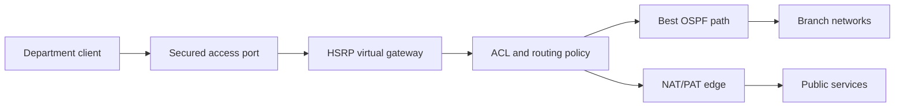

# Resilient Enterprise Network Capstone

> A Packet Tracer/GNS3-ready enterprise lab demonstrating resilient routing, switching, segmentation, edge services, security controls, observability and failure testing.

## Project status

| Item | Value |
|---|---|
| Difficulty | **9.8/10 - advanced capstone** |
| Primary platform | Cisco Packet Tracer 8.x or GNS3 with equivalent IOS images |
| Routing | Multi-area OSPFv2 and OSPFv3 |
| Gateway redundancy | HSRP with preemption |
| Switching | 802.1Q, LACP EtherChannel, Rapid-PVST+ |
| Security | ACLs, port security, DHCP snooping, DAI, BPDU Guard, storm control |
| Services | DHCP relay, DNS, NTP, syslog, SNMP and NAT/PAT |
| Addressing | Structured IPv4 plus IPv6 dual stack |

## Why this is a 9.8/10 project

The difficulty comes from making several control-plane, data-plane and security features work together. A successful result must survive gateway, uplink and WAN failures while maintaining correct VLAN isolation, dynamic routing, address assignment, internet translation and monitoring. The project is graded by evidence, not only by green links.

## Architecture

```mermaid
flowchart TB
  Internet["Simulated Internet and Public Server"]
  ISP["ISP-R1"]
  R1["HQ-EDGE-R1 - HSRP Active"]
  R2["HQ-EDGE-R2 - HSRP Standby"]
  C1["HQ-CORE-SW1 - STP Root A"]
  C2["HQ-CORE-SW2 - STP Root B"]
  A1["HQ-ACCESS-SW1"]
  BR["BRANCH-R1 - OSPF ABR"]
  BA["BRANCH-ACCESS-SW1"]
  ISP --- Internet
  ISP --- R1
  ISP --- R2
  R1 --- C1
  R2 --- C2
  C1 == "LACP EtherChannel" == C2
  C1 --- A1
  R1 == "Primary OSPF WAN" == BR
  R2 -. "Backup OSPF WAN" .- BR
  BR --- BA
```

### Traffic and control flow



## Implemented capabilities

- Departmental segmentation for Administration, Engineering, Finance, Voice, Servers, Guests and Management.
- HSRP virtual gateways with deterministic active/standby roles and preemption.
- Dual routed WAN links with OSPF costs controlling primary and backup paths.
- OSPF area 0 at headquarters and area 10 at the branch, with branch summarization.
- OSPFv3-ready IPv6 routing on selected dual-stack networks.
- LACP EtherChannel between core switches and Rapid-PVST+ load sharing.
- DHCP relay to a central server at `10.10.50.10`.
- Guest ACL that blocks RFC1918 enterprise destinations while allowing public access.
- NAT/PAT through redundant edge routers to a simulated ISP.
- Port security, DHCP snooping, Dynamic ARP Inspection, BPDU Guard and storm control.
- NTP, syslog and SNMP hooks for operational visibility.
- Normal-state, failover, security-negative and recovery test plans.

## Repository layout

```text
enterprise_network_capstone/
|-- README.md
|-- configurations/
|   |-- HQ-EDGE-R1.cfg
|   |-- HQ-EDGE-R2.cfg
|   |-- BRANCH-R1.cfg
|   |-- ISP-R1.cfg
|   |-- HQ-CORE-SW1.cfg
|   |-- HQ-CORE-SW2.cfg
|   |-- HQ-ACCESS-SW1.cfg
|   `-- BRANCH-ACCESS-SW1.cfg
|-- diagrams/
|   |-- enterprise_topology.png
|   `-- failure_domains.png
|-- documentation/
|   |-- Advanced_Enterprise_Network_Report.docx
|   |-- Advanced_Enterprise_Network_Report.pdf
|   |-- ip-addressing-plan.csv
|   |-- vlan-plan.csv
|   `-- packet-tracer-build-guide.md
`-- tests/
    |-- acceptance-test-plan.md
    `-- evidence-checklist.md
```

## Quick start

1. Open Packet Tracer and place four routers, two core switches, two access switches, a server and representative clients.
2. Cable the devices according to `diagrams/enterprise_topology.png`.
3. Rename every device before configuration.
4. Paste the matching file from `configurations/` into each Cisco IOS CLI.
5. Configure the Server VLAN host as `10.10.50.10/24`, gateway `10.10.50.1`, then enable DHCP, DNS, NTP and syslog services.
6. Create DHCP scopes using the VLAN plan and exclude gateway/infrastructure addresses.
7. Configure the public test server as `203.0.113.10/24`, gateway `203.0.113.1`.
8. Run every test in `tests/acceptance-test-plan.md` and capture the evidence listed in `tests/evidence-checklist.md`.
9. Save the simulator project as `Resilient_Enterprise_Network_Capstone.pkt`.

## Core verification commands

```text
show standby brief
show ip ospf neighbor
show ip route ospf
show ipv6 ospf neighbor
show etherchannel summary
show spanning-tree root
show interfaces trunk
show ip dhcp snooping
show ip arp inspection
show port-security interface fastEthernet0/1
show access-lists
show ip nat translations
show logging
```

## Failure demonstrations

| Scenario | Action | Required evidence |
|---|---|---|
| Gateway failure | Shut down `HQ-EDGE-R1 G0/0` | HSRP moves to R2 and client traffic recovers |
| Primary WAN failure | Shut down `HQ-EDGE-R1 G0/1` | Branch route changes to the higher-cost backup path |
| EtherChannel member loss | Shut one channel member | Port-channel remains operational with reduced bandwidth |
| Rogue DHCP server | Connect an unauthorized DHCP server | Offers from the untrusted access port are dropped |
| STP protection | Connect a switch sending BPDUs to an edge port | BPDU Guard places the port into error-disabled state |
| Guest isolation | Ping an internal server from VLAN 60 | Internal access fails while public access succeeds |

## Evidence standard

Do not claim a feature works from configuration alone. Store topology screenshots, command outputs, successful tests, intentionally failed security tests, convergence observations and recovery results. Replace expected-result placeholders in the report with your own simulator screenshots before final submission.

## Design trade-offs

- Router-on-a-stick is retained so HSRP and VLAN tagging remain visible and explainable; a production campus would commonly move gateways to redundant multilayer switches.
- `/24` user subnets prioritize readability and expansion space, while `/30` WAN links conserve addresses.
- Area 10 isolates branch topology changes and permits summarization without making the lab too large for student hardware.
- The native VLAN is an unused parking VLAN, reducing exposure to VLAN-hopping mistakes.

## Portfolio statement

Designed and validated a resilient multi-site enterprise network with HSRP gateway redundancy, multi-area OSPF/OSPFv3, LACP EtherChannel, Rapid-PVST+, IPv4/IPv6 addressing, DHCP relay, ACL segmentation, NAT/PAT, Layer 2 security controls, observability services and documented failure-recovery testing.

## Author

**Mohammed Ishan**  
Bachelor of Computer Science, University of Colombo School of Computing
